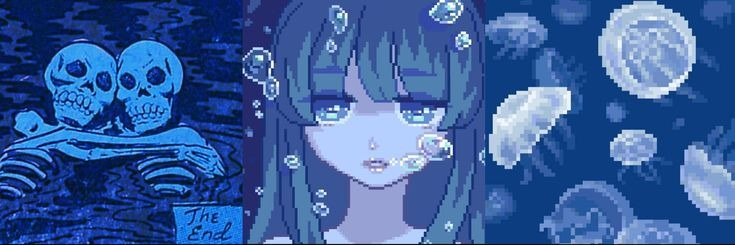

  

  

   
  

  

    🎓 Final-year Software Engineering student @ <b>FPT University Hanoi</b> &middot; 💼 Java Backend Intern @ <b>VNPT Cloud</b>
  

  

    
    
    
    
    
    
  

##  Core Engineering Focus

<table>
  <tr>
    <td width="22%" align="center" valign="middle">
      
    </td>
    <td width="78%" valign="middle">
      Dedicated to architecting <b>low-latency, fault-tolerant distributed systems</b> and high-throughput backend services. Specialized in building scalable microservices with <b>Spring Boot 3</b>, designing asynchronous event pipelines via <b>Apache Kafka</b>, and enforcing high-concurrency data consistency with <b>Redis distributed locks</b>. Experienced in competitive problem solving, memory optimization, and low-level IoT systems in <b>C++</b>.
    </td>
  </tr>
</table>

##  Tech Stack & Tooling

  

##  Engineering Analytics & Problem Solving

  

 

<table width="100%">
  <tr>
    <td width="50%" align="center" valign="middle">
      
    </td>
    <td width="50%" align="center" valign="middle">
      
    </td>
  </tr>
</table>

 

  <picture>
    <source media="(prefers-color-scheme: dark)" srcset="https://raw.githubusercontent.com/Khanhnv26/Khanhnv26/output/github-contribution-grid-snake-dark.svg"/>
    <source media="(prefers-color-scheme: light)" srcset="https://raw.githubusercontent.com/Khanhnv26/Khanhnv26/output/github-contribution-grid-snake.svg"/>
    
  </picture>

 

  

    <b>Designed with focus &bull; Built for high concurrency &bull; &copy; 2026 Nguyen Van Khanh</b>
  

  

